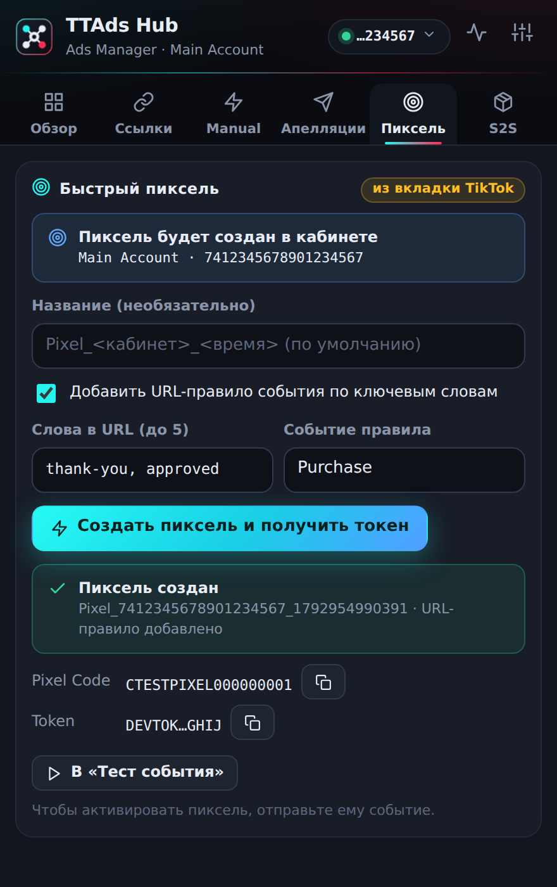
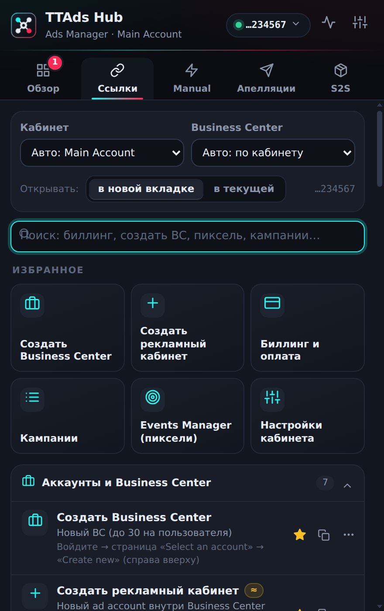
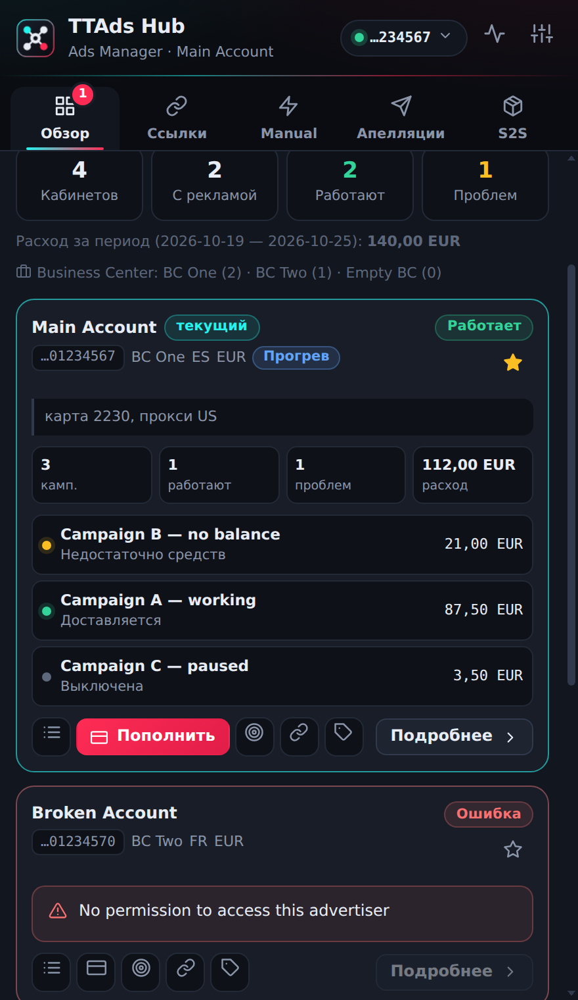
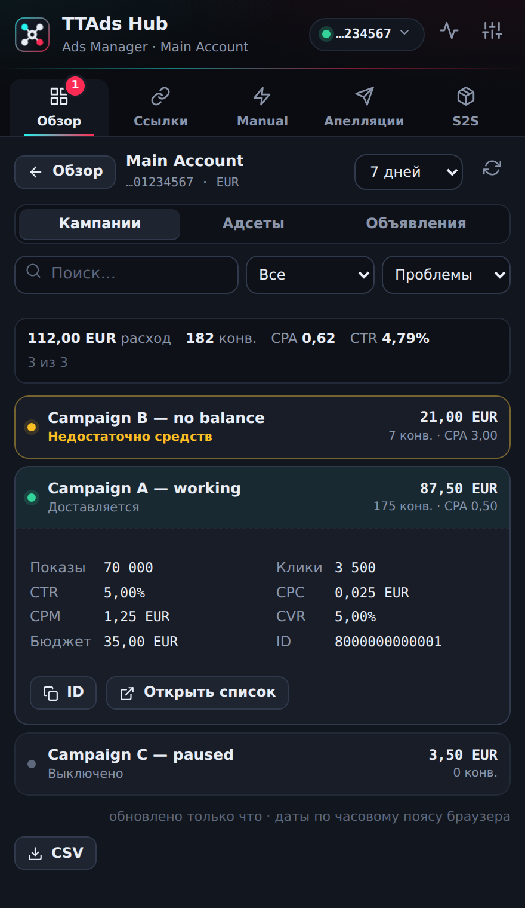

# TTAds Hub

Одно расширение Chrome для TikTok Ads Manager: **быстрые ссылки** (Business Center, создание кабинетов, биллинг и все рабочие разделы), **обзор и мониторинг кабинетов**, **просмотр кампаний/адсетов/объявлений**, **Manual-кампании**, **массовые апелляции**, **S2S-постбэки** и **быстрые пиксели** — в одном окне, с общим журналом и настройками.

## Что нового в 1.2.1

**Вкладка «Пиксель».** Быстрое создание пикселя вынесено из S2S на отдельную вкладку: кнопка видна сразу, показано, в каком кабинете создастся пиксель, а если открыта не та вкладка (Business Center или адрес без `aadvid`), сказано, что открыть. «Создать пиксель» в «Ссылках» ведёт прямо на неё и в поиске стоит первым; страницу Events Manager по-прежнему открывает «Events Manager (пиксели)». Готовые код и токен одной кнопкой переходят в «Тест события».



## Что нового в 1.2.0

| | |
| --- | --- |
| 🔗 **Ссылки** | 45 проверенных ссылок в шести группах + свои. Адрес собирается под выбранный кабинет и Business Center. Избранное, недавние, поиск на русском и английском, «сохранить эту страницу как ссылку», подмена адреса любой ссылки. Omnibox: `tt биллинг` в адресной строке. |
| 🏢 **Создать BC и кабинет** | «Создать Business Center» и «Создать рекламный кабинет» — в один клик, с официальным путём по меню в подсказке. |
| 🔁 **Переключатель кабинетов** | Чип кабинета в шапке → список по Business Center → переход на другой кабинет **с сохранением страницы** (биллинг остаётся биллингом). |
| 📊 **Обзор** | Все кабинеты и BC, состояние доставки, причины («Недостаточно средств» → кнопка «Пополнить»), фильтры, поиск, сортировка, закрепление, метки и заметки, период, экспорт CSV/JSON. Данные кэшируются — повторное открытие не шлёт запросов. |
| 🔍 **Просмотр объектов** | По кнопке «Подробнее»: кампании, адсеты, объявления с расходом, конверсиями, CPA, CTR, CPC, CPM, CVR, причинами недоставки и модерации; фильтры, сортировка, CSV; отклонённое объявление → «К апелляциям». |
| 🔔 **Мониторинг** | Автопроверка по таймеру: число проблемных кабинетов на значке расширения и (по желанию) уведомление о новых проблемах. По умолчанию выключено. |

  

## Установка

1. Распакуйте архив `TTAds-Hub-1.2.1.zip`.
2. Откройте `chrome://extensions` (в антидетект-браузере — страницу расширений профиля) и включите **режим разработчика**.
3. Нажмите **«Загрузить распакованное расширение»** и выберите папку **`TTAds-Hub`** (в ней лежит `manifest.json`).
4. Закрепите расширение на панели браузера. Старые Plusone / MNL / Appeal Desk и предыдущие версии TTAds Hub отключите.
5. Обновив расширение, перезагрузите вкладку TikTok Ads Manager (F5).

Обновление с 1.0/1.1: настройки сохраняются. Добавлено разрешение `alarms` (таймер мониторинга); `notifications` запрашивается только когда вы включаете уведомления.

## Быстрые ссылки

Вкладка **«Ссылки»** (или `tt …` в адресной строке, или `Alt+Shift+K`, чтобы открыть панель).

- **Контекст.** Сверху — кабинет и Business Center. По умолчанию «Авто»: кабинет открытой вкладки, иначе последний открытый; BC определяется по кабинету. Можно выбрать любой кабинет вручную — все ссылки подставят его ID.
- **Избранное** — плитки сверху (по умолчанию: создать BC, создать кабинет, биллинг, кампании, Events Manager, настройки). Звезда у любой ссылки добавляет её в избранное.
- **Открытие.** Переключатель «в новой вкладке / в текущей». `Ctrl`/`Shift`/средняя кнопка — наоборот. `Enter` в поиске открывает лучший результат.
- **Группы:** Аккаунты и Business Center · Биллинг и оплата · Управление рекламой · Ресурсы и креативы · Модерация и политики · Справка и документация · Мои ссылки. Полный список — в [`extension/docs/quick-links.md`](extension/docs/quick-links.md).
- **Свои ссылки** (трекер, прокси-панель, сервис карт…): «Своя ссылка» или «Сохранить эту страницу» — ID кабинета и BC в адресе заменяются на `{aadvid}` и `{bcid}`, ссылка работает для любого выбранного кабинета. Принимаются только `https://` и `http://`.
- **Свой адрес для встроенной ссылки:** меню `⋯` → «Свой адрес…». Так можно закрепить точную страницу из вашего кабинета, если стандартная вам не подходит.

**Достоверность адресов.** Маршруты разделов Ads Manager (кампании, биллинг, события, отчёты…) наблюдались в живом кабинете. Адреса справки, регистрации, Creative Center, Ad Library и Pixel Helper взяты из официальных материалов TikTok. Внутренние страницы Business Center публично не документированы: ссылки на них помечены «≈» (адрес собран по структуре и не проверялся), а в подсказке указан путь по меню: *«Create new» на странице «Select an account»* для нового BC и *Accounts → All accounts → Advertiser accounts → Add advertiser account → Create New* для нового кабинета. Если «≈»-страница не открылась — пройдите путь из подсказки и сохраните настоящий адрес через «Сохранить эту страницу» → «Свой адрес…».

## Обзор и просмотр объектов

- **Состояния кабинета:** работает · не доставляется · выключено · нет рекламы · ошибка доступа. Причины переводятся на русский (нет средств, закончился бюджет, на модерации, отклонено, расписание).
- **Карточка:** ID (клик — копировать), BC, страна и валюта, KPI, кампании, быстрые кнопки (кампании, биллинг/пополнить, Events Manager, настройки, все ссылки кабинета), **метка и заметка** (например «Прогрев · карта 2230»), закрепление сверху.
- **Фильтры** (все / проблемы / работают / выкл.), поиск по названию, ID, BC, метке и заметке, сортировка, период (сегодня, вчера, 7, 30 дней — по часовому поясу браузера).
- **Экспорт** CSV (Excel, защита от формул) и JSON.
- **Подробнее:** выбор уровня (кампании · адсеты · объявления), расход, конверсии, CPA, CTR; раскрытие строки показывает показы, клики, CPC, CPM, CVR, бюджет и ID.

Данные читаются через вашу открытую вкладку TikTok Ads Manager теми же внутренними запросами, что и сам сайт. Только чтение — расширение ничего не включает, не останавливает и не меняет в рекламе.

## Мониторинг

Настройки → «Мониторинг кабинетов»: автопроверка каждые 5–60 минут. Значок на иконке расширения показывает число проблемных кабинетов (красный). Уведомление приходит, когда кабинет **перестал** доставлять рекламу или стало больше проблемных кампаний; первая проверка — базовая линия без уведомления. Нужна хотя бы одна открытая вкладка ads.tiktok.com (проверка идёт через неё). Каждая проверка делает по одному запросу на кабинет — не ставьте слишком часто.

## Остальное

### ⚡ Manual
1. В TikTok Ads Manager нажмите **«Создать»** и выберите цель: **App Promotion**, **Lead Generation** или **Sales**.
2. Откройте расширение → **«Включить Manual»**. Расширение подтвердит окно создания, перехватит штатное сохранение черновика, отправит его заново с Manual-флагами и покажет ручной вариант.

**Режим MNL** (дополнительно): перехват флагов автоматизации в запросах и ответах TikTok (1 → 0) и автоклик по меткам. Метки и поля настраиваются в ⚙.

### 📨 Апелляции
Откройте список Ad (или Ad group) → вкладка «Апелляции» → выберите строки → «Апелляция» → причина, текст, подтверждение → «Отправить». Запросы идут от имени вашей сессии по 3 одновременно; пачка работает в фоне, есть «Остановить». Повтор блокируется до явного отказа, лимит TikTok (код 90071) не обходится, `code=0` без подтверждения статуса считается «не подтверждено». Вкладку TikTok закрывать нельзя.

### 🎯 Пиксель
Создаёт пиксель в открытом кабинете от имени вашей сессии, по желанию добавляет URL-правило события по ключевым словам (по умолчанию `thank-you`, `approved`; до пяти слов) и сразу получает Developer token. Кнопка «В «Тест события»» переносит код и токен на вкладку S2S, чтобы отправить первое событие. Нужна открытая вкладка ads.tiktok.com с `aadvid` в адресе.

### 🔗 S2S
Ссылка постбэка для Keitaro, архив `S2S_TTAds.zip` (PHP-скрипт, Events API 1.0/2.0, `&dry=1` для проверки), тест события. Тест отправляет **настоящее** событие — используйте API 2.0 и `test_event_code`.

### 📜 Журнал
Кнопка в шапке: переключения Manual, правки MNL, итоги апелляций, проверки мониторинга, тесты S2S. Экспорт в JSON.

## Что улучшено по сравнению с исходными расширениями

| Область | Улучшение |
| --- | --- |
| Всё | Один интерфейс, общий журнал, тёмная/светлая тема, экспорт/импорт настроек (включая избранное, свои ссылки, метки кабинетов) |
| Manual | Код Plusone очищен от обфускации и серверных «рецептов»; запросы идут только на `ads.tiktok.com`. Если Manual уже виден в редакторе, расширение ничего не сохраняет повторно |
| MNL | Хуки ставятся, только когда режим включён; автоклик нажимает каждую метку один раз; поддерживаются поля `spc_*` и `soc_*` |
| Апелляции | Отправка в сервис-воркере: закрытие окна не теряет пачку; ограничение параллелизма, «Остановить», итоги с группировкой ошибок, история и шаблоны; длинные ID не теряют точность |
| S2S | PHP-скрипт не зависит от ipify, игнорирует неподставленные макросы Keitaro, поддерживает `api=2`, `currency`, `test`, `event_id`, `dry=1`, отдаёт поле `ok`; битые значения не ломают запрос |

## Важно знать

- **Проверка.** Расширение прошло 97 юнит-тестов и 159 e2e-проверок в настоящем Chrome на моке TikTok Ads Manager (мок повторяет маршруты и ответы, описанные в `extension/docs`). На живом кабинете TikTok эта сборка не запускалась. Для списков кампаний и кабинетов используются запросы, подтверждённые в вашей разведке; имена полей **адсетов и объявлений** выведены по аналогии и могут отличаться — тогда в таблице появятся прочерки, а не неверные цифры.
- **Что не сделано и почему.** Запуск/пауза объектов, изменение бюджета, ставок, расписания и массовое переименование через внутренний API: в документации контракты этих запросов отмечены как нераскрытые, а ошибка здесь стоит денег. Эти действия вынесены в следующий этап — для них нужен перехваченный реальный запрос (см. `extension/docs/tiktok-ads-capability-map.md`, раздел «Обнаруженные операции изменения»). Не вошли также официальный Marketing API с OAuth, импорт из Meta и создание автоправил.
- **Срок жизни Manual.** TikTok анонсировал, что с **1 января 2027** Marketing API перестанет создавать Legacy Manual-кампании для Sales, App Promotion и Lead Generation.
- **Риски.** Расширение автоматизирует внутренние запросы Ads Manager; TikTok может менять их и ограничивать автоматизацию. Используйте на свой риск.
- **Приватность.** Данные хранятся локально (`chrome.storage`). Запросы идут только на `ads.tiktok.com` и `business-api.tiktok.com`. Пароли, cookies и токены расширением не сохраняются; Access Token S2S-теста живёт до закрытия браузера.
- **Документы разведки** лежат в [`extension/docs`](extension/docs): карта возможностей, каталог внутренних адресов, реестр возможностей, журнал проверки мутации (идентификаторы заменены) и список ссылок. Файл `live-account-snapshot-*.json` с реальными ID кабинетов и платёжными данными намеренно **не** включён в публичный репозиторий и сборку.

## Разработка

```bash
npm install          # playwright-core для e2e и иконок
npm test             # 97 юнит-тестов (node:test; тесты PHP-скрипта требуют установленного php)
npm run test:e2e     # e2e в Chrome на моке TikTok: ядро + новые функции (нужны Chrome и openssl, CHROME_PATH)
npm run docs:links   # пересобрать extension/docs/quick-links.md из каталога ссылок
npm run build        # dist/TTAds-Hub-<версия>.zip
npm run icons        # перерисовать иконки из extension/assets/logo.svg
```

Структура: `extension/background` — сервис-воркер и движки (`manual`, `appeals`, `s2s`, `overview`, `explorer`, `monitor`, `accounts`, `links`, `data`), `extension/content` — перехватчик MNL, агент страницы, сканер таблиц, `extension/ui` — интерфейс, `extension/docs` — документы, `tests` — юнит- и e2e-тесты, `scripts` — сборка.

## Источники

Основано на Plusone 3.0.10 (@plusonetm), MNL Campaign Control 4.0, Appeal Desk / tiktok-appeal-helper 0.29, S2S_TTAds и TTAds Hub 1.1 (вкладка «Обзор» и разведка TikTok Ads). Адреса ссылок сверены с официальной справкой TikTok for Business. Лицензия исходных расширений не указана.
