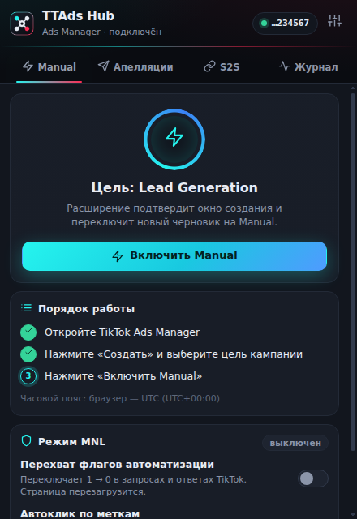
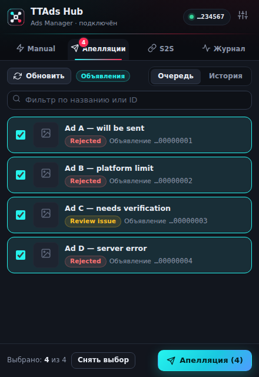
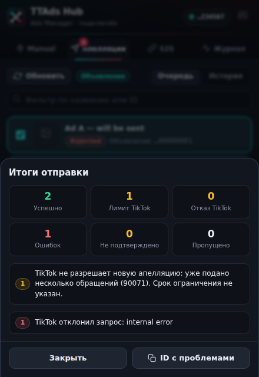
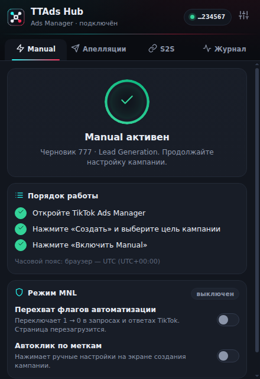
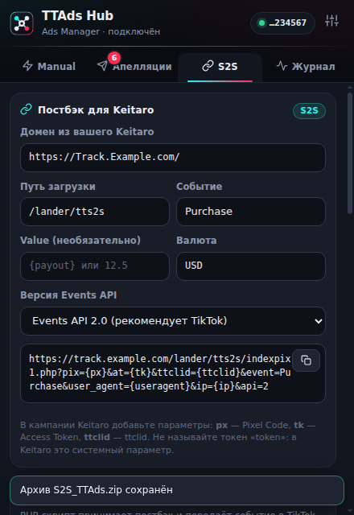
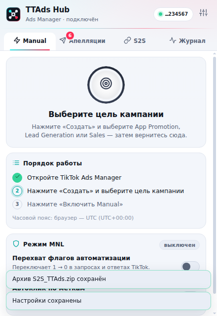

# TTAds Hub

Одно расширение Chrome для TikTok Ads Manager вместо четырёх: **Manual-кампании**, **массовые апелляции**, **S2S-постбэки** и **быстрые пиксели** — в одном окне, с единым журналом и настройками.

## Интерфейс

| Manual | Апелляции | Итоги отправки |
| --- | --- | --- |
|  |  |  |

| Manual активен | S2S | Светлая тема |
| --- | --- | --- |
|  |  |  |

*Скриншоты сняты на моке Ads Manager — данные вымышленные.*

## Установка

1. Распакуйте архив `TTAds-Hub-1.0.0.zip`.
2. Откройте `chrome://extensions` (в антике — страницу расширений профиля) и включите **режим разработчика**.
3. Нажмите **«Загрузить распакованное расширение»** и выберите папку **`TTAds-Hub`** (в ней лежит `manifest.json`).
4. Закрепите расширение на панели браузера.
5. Старые Plusone / MNL / Appeal Desk отключите — они делают то же самое и будут мешать.

После обновления расширения перезагрузите вкладку TikTok Ads Manager (F5).

## Как пользоваться

### ⚡ Manual
1. В TikTok Ads Manager нажмите **«Создать»** и выберите цель: **App Promotion**, **Lead Generation** или **Sales**.
2. Откройте расширение → **«Включить Manual»**. Расширение подтвердит окно создания, перехватит штатное сохранение черновика, отправит его заново с Manual-флагами и покажет ручной вариант.
3. Статус и ошибки видны в карточке; **«Отмена»** снимает ожидание.

Если черновик уже открыт — кнопка работает сразу. Публикация кампании расширением не выполняется.

**Режим MNL** (дополнительно): перехват флагов автоматизации в запросах и ответах TikTok (1 → 0) и автоклик по меткам («Select placement», «Manual campaign» и т.д.). Метки и список полей настраиваются в ⚙. Включайте, если основной способ не сработал.

### 📨 Апелляции
1. Откройте в TikTok список **Ad** (или **Ad group**), отфильтруйте объявления со статусом Rejected / Review issue.
2. Вкладка **«Апелляции»** сама найдёт строки. Выберите нужные (на уровне Ad group вложенные объявления подгрузятся автоматически).
3. **«Апелляция»** → причина, текст (шаблон или свой), галочка подтверждения → **«Отправить»**.
4. Запросы идут от имени вашей сессии TikTok по 3 одновременно (меняется в ⚙). Окно расширения можно закрыть — отправка продолжится в фоне, итог покажется при следующем открытии. **Вкладку TikTok закрывать нельзя**: запросы выполняются внутри неё. Кнопка «Остановить» прекращает запуск оставшихся.

Защита: повторная отправка блокируется, пока нет явного отказа; лимит TikTok (код **90071**) не обходится; `code=0` без подтверждения статуса считается «не подтверждено». Во вкладке **«История»** можно снять блокировку с зависших записей.

### 🔗 S2S
- **Постбэк для Keitaro** — вводите домен и событие, получаете готовую ссылку (`px`, `tk`, `ttclid`, `user_agent`, `ip`).
- **Серверный скрипт** — скачивание `S2S_TTAds.zip` (загрузить в Keitaro → Лендинги по пути `/lander/tts2s`). Добавьте `&dry=1` к ссылке, чтобы увидеть, что было бы отправлено, не обращаясь к TikTok.
- **Тест события** — отправка события в TikTok Events API (1.0 или 2.0) с вашим Pixel Code и токеном. Это **настоящее** событие: чтобы не засорять статистику, используйте API 2.0 и `test_event_code` из Events Manager → Test Events.
- **Быстрый пиксель** — создаёт пиксель в открытом кабинете, добавляет URL-правило и получает Developer token.

### 📜 Журнал
Все действия: переключения Manual, правки MNL, итоги апелляций, тесты S2S. Экспорт в JSON.

## Что улучшено по сравнению с исходными расширениями

| Область | Улучшение |
| --- | --- |
| Всё | Один интерфейс, одна иконка, общий журнал, тёмная/светлая тема, настройки с экспортом/импортом |
| Manual | Код Plusone очищен от обфускации и серверных «рецептов»; запросы идут только на `ads.tiktok.com`. Если Manual уже виден в редакторе, расширение только показывает его и ничего не сохраняет повторно. Живые подсказки: что выбрано и что делать дальше |
| MNL | Хуки ставятся только когда режим включён (иначе страница не тронута). Автоклик нажимает каждую метку один раз — повторный клик по переключателю возвращал бы его назад. Поддерживаются поля `spc_*` и `soc_*` |
| Апелляции | Отправка идёт в сервис-воркере: закрытие окна расширения не теряет пачку; потеря вкладки останавливает отправку, а не оставляет «зависшие» записи. Ограничение параллелизма, кнопка «Остановить», итоги с группировкой ошибок, история со снятием блокировки, шаблоны текста. Длинные ID объявлений не теряют точность |
| S2S | PHP-скрипт больше не зависит от ipify (раньше при его сбое события не уходили), неподставленные макросы Keitaro игнорируются, добавлены `api=2`, `currency`, `test`, `event_id`, `dry=1`, поле `ok` в ответе; битые значения (`value=1e999`, невалидный UTF-8) больше не ломают запрос. Исправлена ошибка с неопределёнными переменными прокси |

## Важно знать

- **Проверка.** Расширение прошло 50 юнит-тестов и 62 e2e-проверки в настоящем Chrome на моке TikTok Ads Manager (мок повторяет селекторы и внутренние API, с которыми работают исходные расширения). На живом кабинете TikTok оно не запускалось — внутренние эндпоинты TikTok не документированы и меняются. Быстрая проверка: создать черновик Lead Generation → «Включить Manual».
- **Срок жизни Manual.** TikTok анонсировал, что с **1 января 2027** Marketing API перестанет создавать Legacy Manual-кампании для Sales, App Promotion и Lead Generation. Работа Manual-режима после этой даты не гарантируется.
- **Риски.** Расширение автоматизирует внутренние запросы Ads Manager. TikTok может ограничивать такие действия; используйте на свой риск и не злоупотребляйте апелляциями.
- **Приватность.** Данные хранятся локально (`chrome.storage`). Токен S2S-теста живёт только до закрытия браузера. Access Token в ссылке постбэка Keitaro попадает в логи вашего сервера и трекера — ограничьте к ним доступ. Запросы идут только на `ads.tiktok.com` и `business-api.tiktok.com`, аналитики и удалённого кода нет.
- **Не вошло.** Прокладки `TTAds_Prokladka*` в объединение не включались.

## Разработка

```bash
npm install          # playwright-core для e2e и иконок
npm test             # 50 юнит-тестов (node:test; тесты PHP-скрипта требуют установленного php)
npm run test:e2e     # e2e в Chrome на моке TikTok (нужны Chrome и openssl, CHROME_PATH)
npm run build        # dist/TTAds-Hub-<версия>.zip
npm run icons        # перерисовать иконки из extension/assets/logo.svg
```

Структура: `extension/background` — сервис-воркер и движки (`manual`, `appeals`, `s2s`), `extension/content` — перехватчик MNL (MAIN-мир), агент страницы и сканер таблиц, `extension/ui` — интерфейс, `tests` — юнит- и e2e-тесты.

## Источники

Основано на Plusone 3.0.10 (@plusonetm), MNL Campaign Control 4.0, Appeal Desk / tiktok-appeal-helper 0.29 и S2S_TTAds из Telegram-канала «Сергей Столяров | TikTok Ads». Код перенесён и переработан; лицензия исходных расширений не указана.
